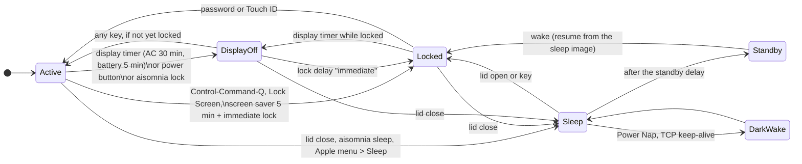

# States and transitions

macOS has five states that matter here. "Display off" and "locked" are independent: a dark screen can be unlocked and a lock screen can be lit. The network is down in normal sleep except during short Power Nap wakes.

| State | Display | Locked | CPU and work | Network | How you get there | How you leave |
|---|---|---|---|---|---|---|
| Active | on | no | runs | up | wake and authenticate | timers, keys, lid |
| Display off | off | not until the lock delay | runs | up | display timer, power button, `aisomnia lock` | any key |
| Locked | on or off | yes | runs | up | screen saver + immediate lock, Control-Command-Q, display off + immediate lock | password or Touch ID |
| Sleep | off | yes on wake | halted | down (dark wakes excepted) | lid close only, once the profile is applied | lid open, key, power button |
| Standby (deep sleep) | off | yes on wake | halted, RAM off | down | macOS after the standby delay | power button, lid open |

## Force and hold

| State | Happens when | Force it now | Hold it off once |
|---|---|---|---|
| Active | Any wake | `aisomnia wake-at "2026-01-15 07:30"`, `aisomnia wake-in 2h` | not applicable |
| Display off | Display timer; power button; `aisomnia lock` | `aisomnia display-off` | `aisomnia hold display 2h` |
| Locked | Screen saver after 5 min; display off; Control-Command-Q; Touch ID press | `aisomnia lock` | `aisomnia hold lock 1h` (only while you are at the Mac) |
| Sleep | Lid close (idle sleep is off, the button no longer sleeps) | `aisomnia sleep` | `aisomnia hold lid 2h` (sudo once; ends at 20 % battery) |
| Standby | During sleep, after macOS's standby delay | `aisomnia hibernate` | `aisomnia hold standby 8h` (sudo once) |
| Dark wake | During sleep: Power Nap, TCP keep-alive | not forceable | set `powernap = 0` in the profile |
